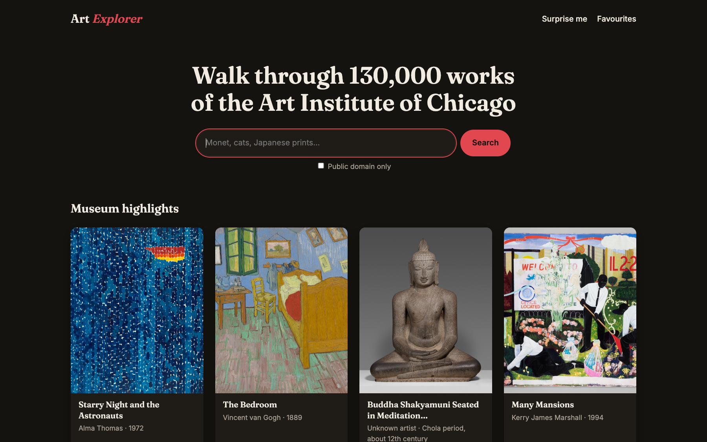

# Art Explorer

A website built with **Python, Flask and Requests** for browsing the collection of the [Art Institute of Chicago](https://www.artic.edu/). Search more than 130,000 artworks, open any of them in high resolution, discover a random piece and keep your favourites. All data comes live from the museum's public REST API, which needs no API key.



## Features

- **Search**: find artworks by artist, title, subject or style, 12 per page, with page navigation.
- **Museum highlights**: an empty search shows the works that the museum itself marks as highlights.
- **Public domain filter**: show only works that are free to use.
- **Artwork page**: a large image with the date, medium, dimensions, origin, style, department, credit line and the museum's description, plus a link to the work on artic.edu.
- **Surprise me**: opens a random public-domain artwork from the whole collection.
- **Favourites**: save artworks with one click. The list lives in the session cookie, so no account is needed.
- **Fast loading**: every card shows a tiny blurred preview (`lqip`) from the API while the real image loads, and gallery images use `loading="lazy"`.
- **Friendly errors**: if the API is slow or down, or an artwork does not exist, the site shows a clear message instead of a crash.
- **Works without JavaScript**, adapts to phones, and has an automatic light and dark theme.

## How it works

| Request | What the app does |
|---|---|
| `GET /` | `POST /artworks/search` with an Elasticsearch-style body: the search text in `q`, filters in `query.bool.filter` (has an image, public domain, highlights) and only the `fields` the card needs |
| `GET /artwork/<id>` | `GET /artworks/<id>?fields=...` and a 404 page when the API answers 404 |
| `GET /random` | a search filtered by `id >= random number`, sorted by `id`, `limit=1` |
| `GET /favourites` | one `GET /artworks?ids=1,2,3` request for all saved works |
| `GET /image/<image_id>` | downloads the picture from the museum's [IIIF](https://iiif.io/) server (`/iiif/2/<image_id>/full/843,/0/default.jpg`) and passes it on to the browser, cached for a day |

### Things I learned about this API

- **Search stops at 1,000 results.** Asking for `offset + limit > 1000` returns `403 "Invalid number of results"`, so the pager is capped at 83 pages.
- **That is also why "random" cannot just pick a random page.** Elasticsearch's `random_score` is accepted but has no effect, so the app picks a random `id` and takes the first public-domain artwork at or after it.
- **The description is HTML.** The app keeps only the text of each paragraph (`Markup.striptags`), so no foreign markup ends up on the page.
- **Images need the `AIC-User-Agent` header too.** Without it the IIIF server answers `403`. A browser cannot add custom headers to an `` tag, so Flask fetches each image itself with the header and serves it from `/image/<image_id>`. Only real UUIDs are accepted as `image_id`, so nothing else can be put into the museum URL.

## Python tools and techniques used

| Tool | What it does in this project |
|---|---|
| **Flask** | Routes, `redirect`/`url_for`, `abort(404)`, custom `errorhandler`s, `flash` messages and a `context_processor` |
| **Jinja2** | Template inheritance (`extends`/`block`), a shared card `include`, loops over a list of `(label, field)` pairs for the details table |
| **Requests** | Calls to the REST API with a `timeout`, a custom header, `params` for GET and `json=` for POST; network errors are turned into one `ApiError` |
| **Flask `session`** | A signed cookie that stores the list of favourite IDs |
| **pytest** + `monkeypatch` | Tests replace `requests.request` with a fake, so they run offline and check exactly what is sent to the API |

## Run locally

```bash
python3 -m venv venv
source venv/bin/activate
pip install -r requirements.txt
python app.py
```

Then open http://127.0.0.1:5001. The app does not use port 5000, because on macOS it is taken by the AirPlay Receiver.

Set `SECRET_KEY` in the environment to keep favourites after a restart. Without it a new key is generated on every start.

## Tests

```bash
pip install -r requirements-dev.txt
python -m pytest
```

## Credits

Data and images: [Art Institute of Chicago API](https://api.artic.edu/docs/). Artwork data is CC0; descriptions are CC BY 4.0.
